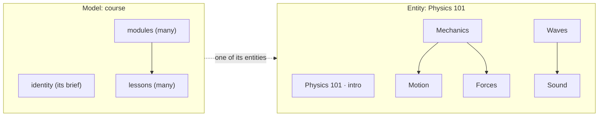
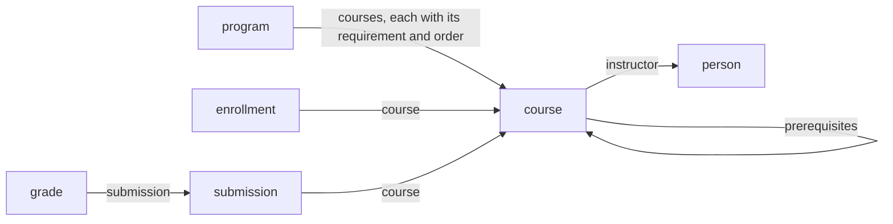

# The Entity Model

The [Application Engine](./the-application-engine.md) keeps a web app's data in its **entity
store**. This guide is about that store: how you model a domain with it, how data is written and
kept, and how that compares with designing tables in a relational database. An application on the
engine never sees the database underneath. It creates no tables, writes no SQL and runs no
migrations: it declares **Models**, and reads and writes **entities**.

For the syntax a Model is written in, see [Data Schemas](../development/data-schemas.md);
for design advice with a worked example, see [Designing Data Schemas](../development/designing-data-schemas.md).

---

## The idea: declare what a thing is

In a relational database, the unit you design is the **table**. A thing your application is about —
a course — is spread across several tables and reassembled by joins, and everything that makes the
data usable is code you write around them: validation beyond column types, who may read what,
translations, the card that shows one thing inside another, history that can't be rewritten, the API.

The entity store moves the design up a level. You declare **what a kind of thing is** — its parts,
its rules, what it points at, and which part is its card — and the engine derives the rest. Every
entity of a Model you declare is:

- **stored, and checked on every write**, whoever writes;
- **read whole**, with each thing it points at shown as a card;
- **shared per entity**, by its owner;
- **held in each language**;
- **changed without migrations**, each change checked against what is already stored;
- **edited in Uniweb App** through forms made from its declaration;
- **served** to the site and the application by the engine.

That is what makes the entity store a higher-order abstraction over a database: the Model says what
the data means, and how it is stored is the engine's business.

## Models and entities, sections and items

Four words carry the whole model. Two are **abstract**, what you declare; two are their **concrete**
counterparts, what you hold:

| You declare | You hold |
|---|---|
| A **Model** — a kind of thing: a course, a person, an enrollment | An **entity** — one thing of that kind: *Physics 101* |
| A **section** — a named part of a Model: a course's modules | An **item** — that part's data in one entity: the module *Mechanics* |

A section declares **fields**, and an item holds their values: a module's `title` is a field, and
*"Mechanics"* its value in one item. A Model is a tree of sections, and each of its entities is a
tree of items that mirrors it:



Every entity has an identity of its own, and so does every item in it. That is what lets one entity
point at another, and a field point at a single item inside an entity.

> **Two words the framework also uses.** On a page, a *section* is a block of content a component
> renders, and its *items* are the groups its markdown repeats (`content.items`). In this guide, a
> section is always a part of a Model, and an item that part's data in an entity.

## Sections are namespaces

A section is a **namespace for structured data**. Its fields are named within it, so a course's
`identity` and its `details` can each hold a `title` without colliding, and a section's own name is
local to what holds it, the Model or a parent section. A section holds **one** item in each entity,
or **many** (`many: true`):

- a single section groups what belongs together: a course's identity, its details;
- a many section is a list of items: a course's modules.

Sections nest, and **nested sections are nested namespaces**: a module's lessons live inside the
module, and each lesson's fields inside the lesson. This is how a Model holds **hierarchy**, of two
kinds:

- **children of another kind** — a module has lessons: a section inside a section, each with fields
  of its own;
- **children of the same kind** — a chapter under a chapter, to any depth: a many section marked
  `tree: true`, whose items nest under each other.

The hierarchy is structure, not wiring. There are no IDs to connect and no back-pointers to keep:
the data tree mirrors the Model's tree.

```yaml
name: course
sections:
  identity:              # the brief: the course at a glance (see "The brief")
    brief: true
    fields:
      title: { type: string, required: true }
      level: { type: string, enum: [intro, intermediate, advanced] }
  details:               # a namespace of its own, for a separate concern
    fields:
      credits: { type: int }
      weeks:   { type: int }
  modules:               # many modules
    many: true
    fields:
      title: { type: string }
    sections:
      lessons:           # many lessons in each module
        many: true
        fields:
          title: { type: string }
          body:  richtext
```

## One Model, many concepts — and when to split

On a relational database, a course with modules and lessons is three tables and the keys between
them. In the entity model it is **one Model**: the modules and lessons are part of the course,
created with it, read with it, removed with it. A Model often holds several concepts of a domain at
once, and that is the point: what belongs together stays together.

A concept gets **a Model of its own** when it differs from what holds it in one of three ways:

- **Identity** — it exists on its own, and other things point at it. An instructor's profile is
  referenced by every course they teach.
- **Lifecycle** — it is created, changed or ended on its own schedule. An enrollment begins when a
  student enrolls and ends when they complete or withdraw, while the course goes on.
- **Permissions** — different people may read or change it. A submission is the student's; the grade
  on it is the instructor's, hidden from the student until it is released.

Domain-driven design draws the same line around an **aggregate**: objects treated as one unit, with
one identity at its root and one boundary for change. An entity is an aggregate, and its items are
the parts inside it; the entity model adds permissions to the reasons for a boundary.

A course platform, modeled this way:

| Model | Holds | A Model of its own because |
|---|---|---|
| course | its identity, its details, its modules and their lessons | — it is the root |
| person | an instructor's public profile | identity: one profile, many courses |
| program | its courses, each required or elective, in an order | identity: a curriculum of its own |
| enrollment | the course, the date, the status | lifecycle and permissions: the student's, from enrolling to completing |
| submission | the exam, and answers that can be added but never rewritten | permissions: the student's |
| grade | the submission it grades, the score, the comments | permissions: the instructor's, until it is released |



*Each box is a Model and each arrow a reference. A course's modules and lessons are not arrows: they
are inside it.*

Not every entity is authored. A course is written by its authors; an enrollment, a submission and a
grade are written by the application as people use it. They are entities of Models all the same,
with owners, permissions and history.

## References

A field can point at an entity of another Model: a **reference**, written `ref`. A reference is
typed — it names the Model it points at, and the engine refuses one that points anywhere else. A
relationship takes one of four shapes, by how much the link itself carries:

| Shape | Example | Use it when |
|---|---|---|
| a reference | a course's instructor | one thing points at another |
| a list of references (`many: true`) | a course's prerequisites | it points at several, and the links carry nothing |
| an item holding a reference and fields of its own | a program's courses, each required or elective, in an order | the relationship has data: the item *is* the link, and its fields are the link's |
| an entity of its own | an enrollment | the relationship has its own identity, lifecycle or permissions |

**A reference to an item.** A field can also point at one item inside an entity. Its everyday use is
a **picklist**: a list kept as content — countries, departments, course levels — in a section of a
lists Model, which a field picks from with `options:`. The field holds a reference to the chosen
item, not a copy of its label, so a label corrected in the list reads corrected wherever it was
picked.

**Reading follows references.** When you read an entity, each reference to another entity arrives
with that entity's brief, and each reference to an item with the item. A reference can also carry
access, opening what holds it or what a purchase reaches ([Ownership and permissions](#ownership-and-permissions)).

## The brief

Every reference raises the same question: when A points at B, what does a reader of A see of B? A
name copied into A goes stale the day B is renamed. All of B is more than the reader needs, and more
than they may be allowed to see.

The **brief** is the answer. It is the one single section of a Model marked `brief: true`,
holding what identifies an entity at a glance: a name, a title, a photo, a date. *Brief* as in short
and essential — not as in a summary. It is not an abstract of the entity's content; it is its card,
and it is exactly what a UI card needs.

The engine keeps every brief current, and it is what a reference to the entity shows and what a list
of entities carries. Two consequences:

- **The brief is seen by whoever can reference the entity.** Keep anything private in another
  section.
- **A Model with no brief can't be referenced.** Content that *is* a list, a menu or a form, has no
  single section to be its card, and needs none.

The date a Model's entities sort by, its `sort_date`, is a field of its brief.

## Values, rules and languages

A field holds a short or long text, a number or a whole number, true or false, a day, a month or a
year, a timestamp, a file or an image, a link or an email address, markdown, rich text, structured
JSON, a reference, or a secret. The full list, with the friendly names you write, is in
[Data Schemas](../development/data-schemas.md#field-types-and-formats). Secrets and
files work unlike other values, and have sections of their own
([Secrets](#secrets-values-no-one-reads-back), [Files and media](#files-and-media-where-they-live-and-who-can-reach-them)).

**Rules are checked on every write.** A field can be required, bounded in length or in value, held to
a pattern or a format, or limited to a closed set of values. A section can say how few or how many
items it holds, which values in it must be unique, and which fields become required when another
holds a given value.

**Rich text is a document, not markup.** It holds a fixed vocabulary — paragraphs, headings, lists,
tables, pictures and formulas among its blocks; bold, italic, underline, superscript, subscript and
links among its marks — and what an editor adds beyond it is left out as it is saved, since how a
text looks is the theme's and the component's ([the full vocabulary](../development/data-schemas.md#rich-content-format)).
A rich-text field can be bounded in length, counted as a reader sees the text.

**Values are held per language.** Text and rich-text fields are translatable unless you say
otherwise (`translatable: false`, for a code or an ID), and each language's value is checked on its
own.

## Ownership and permissions

Every entity has an owner, who can share it with people or teams to read, edit or administer. Access
is decided per entity, on every read and every write, and an entity you may not read is, for you, an
entity that does not exist.

There is no private field. To give part of your data access of its own, make that part an entity of
its own: the grade, apart from the submission. Three declarations shape access from within a Model:

- **`readable_with`** on a reference opens the entity holding it, to read, to whoever holds that
  level on the entity it points at. A submission whose `course` declares `readable_with: edit` can be
  read by the course's staff, and the link opens it to none of the course's students.
- **`sold_with`** on a reference says that buying the entity holding it buys what it names: a buyer
  of a course reads its lessons.
- **`visitor_fills`** on a field lets a site's visitors create entities of the Model without an
  account, confirmed by email: a registration, an inquiry.

## Secrets: values no one reads back

Applications constantly need credentials: a payment provider's key, a token for another system, an
email service's password. A field of kind **`secret`** holds one, and the engine treats it like no
other value:

- **It is set through its own door.** Setting, rotating or clearing a secret takes the right to
  administer the entity, and an ordinary save that carries a value for it is refused.
- **The value stays in the engine.** It is kept, encrypted, in the engine's store for secrets. The
  field holds only a description of it — when it was set, and a mask such as `sk_live_••••1234` — so
  an admin screen can show which key is in place without showing the key, and an export or a copy of the
  data never carries a live credential.
- **Only the engine reads it,** at the moment it uses it — to sign a call to the other system — or to
  hand it to the one service that needs it. No read returns it, to anyone.

A site's own credentials, such as an ad platform's token, are kept the same way: its owner sets them
from Uniweb App or from the CLI (`uniweb site secret`), and the site's next publish delivers them to the
service that uses them.

A secret is for machines. A value a person is meant to read — a grade, a private note — is not a
secret: it is an entity of its own, with a grant, as the grade is.

## Files and media: where they live, and who can reach them

A field of kind `image` or `file` holds a **reference to an uploaded file**, never the file itself: a
picture, a video, a document. It can declare the types and the size it accepts:

```yaml
photo: { type: image, mime_types: ['image/*'], max_size: 2000000 }   # bytes
```

- **Where the bytes go.** An upload goes straight to the engine's file storage, and the file's address
  is made from a fingerprint of its bytes, a SHA-256 hash. The same file always has the same address,
  an identical file is stored once, and a file never changes at its address, so a cache never has to
  check it for changes.
- **Who can reach a file:** anyone who has its address, without signing in. That is what lets a page
  show its pictures. The address can't be guessed — computing it takes the file's own bytes — but it
  is not a secret: permissions protect the entity and the reference in it, not the bytes behind the
  address. Whoever is given the link, or comes across it, can fetch the file.
- **How long a file lasts.** A file stays available while it is in use. Once its storage is freed —
  its entity deleted, for example — the engine may delete it, at a time of its choosing, and how
  storage is freed may change. So don't count on a file outliving its use, nor on its link going dead
  the moment you stop using it.

So a file is **as private as its link**. Keep a document that must stay confidential — an identity
document, a medical record — out of file fields, or treat its address as the credential it then is.

## Lifecycle and change

- **History that can't be rewritten.** A many section marked `append_only: true` takes new items and
  refuses to change or remove old ones, whoever writes: activity logs, submitted answers, audit
  trails.
- **Who made it, who holds it.** Every entity records who created it and who owns it now.
- **A Model changes without migrations.** A new version that keeps the stored entities valid — a
  field or a section added, a label reworded, an option added — applies when you register it. One
  that would break them — a field's type changed, a field removed, a used option dropped, a field
  made required that some entity leaves empty — is refused, naming how many entities it breaks.
- **A Model is a contract, shared by name.** Its identity is its name (`@acme/course`), so a site's
  components can declare the types they render, and one Model serves many projects
  ([Data Schemas as Contracts](../architecture/data-schemas-as-contracts.md)).

## Persisting data

**Every writer passes the same gate.** An author edits in Uniweb App, through forms made from the Model;
a developer pushes records from files (`uniweb push`, and `uniweb pull` to bring them back); the
application writes for its members, through [`@uniweb/api`](./the-sdk.md);
a visitor submits a form. Each write is checked against the same Model, because the rules live in the
Model, not in a form.

**What is stored is what is served.** A value is kept in one spelling — a date in full, a web address
with its scheme — and rich text within its vocabulary, so a reader receives exactly what the write
stored.

**Files or the engine, one model.** A site with no backend keeps its records as files; a solution's
engine stores them as entities. The Models are the same either way, so content moves from one to the
other without being reshaped.

## Modeling a domain, step by step

1. **Name the things** your domain is about: courses, people, programs, enrollments.
2. **Give each its parts.** A section per part, nested where a part has parts of its own, a tree where
   it nests in itself.
3. **Split what differs.** A part with its own identity, lifecycle or permissions gets a Model of its
   own.
4. **Connect them.** A reference for each link; an item with fields of its own when the link carries
   data.
5. **Choose each Model's brief**: what identifies one of its entities at a glance.
6. **Add what the data must keep**: its rules, its languages, the history that can't be rewritten.

[Designing Data Schemas](../development/designing-data-schemas.md) works through
these decisions on a course platform, the exam included.

## The same patterns, other domains

| Domain | One Model holds | Models of their own | References |
|---|---|---|---|
| an academic CV | the CV: its identity, degrees, positions, and publications, each with its co-authors in order | — | a position's organization and country, picked from lists kept as content (`options:`) |
| a conference | the conference: its identity, its days, their sessions | a speaker, who speaks at many sessions; a registration, a visitor's, submitted through a form | a session's speakers |
| a handbook | the handbook: its identity, and chapters under chapters, to any depth (`tree: true`) | — | each chapter's author, a person |

## Compared with a relational database

**If you think in tables:** a section is a table, an item a row, a field a column, a reference a
foreign key — and a Model is the set of tables that make up one kind of thing, kept together as one.

A relational database gives you tables, keys, joins and constraints, and leaves the rest of the
application to you. The entity model is a level above it — the level an application thinks at:

| You need | On a relational database | In the entity model |
|---|---|---|
| a thing with parts | a table per part, and keys between them | one Model, a section per part |
| a hierarchy: course, modules, lessons | a table per level, and joins to reassemble it | nested sections: an entity holds its whole tree |
| a tree of one kind: chapters | a table that points at itself, and recursive queries | a section marked `tree: true` |
| a relationship with data of its own | a join table | an item holding a reference and its own fields |
| a link shown as a card | a foreign key, and a join for its display columns | a reference: its target's brief comes with it |
| a picklist | a lookup table and a foreign key | `options:`, a list kept as content |
| translations | a translations table per table | translatable fields |
| who may read what | a check in every query, or a security policy per table | ownership and grants, decided on every read |
| credentials the application needs | a secrets manager, wired in by hand | a `secret` field: set through its own door, never read back |
| files and media | a column holding a path, and storage you run | an `image` or `file` field: uploaded to the engine, served at an address made from its bytes |
| history that can't be rewritten | triggers, or discipline | `append_only: true` |
| validation | constraints for what SQL can say, and code for the rest | the Model, on every write |
| a change of shape | a migration, and a data migration for what it breaks | a new version of the Model, checked against what is stored |
| an API for a site or an app | written by you | served by the engine |

### Performance

- **Reads, without N+1 queries.** An entity comes back whole — its items, and the briefs of what it
  references — in a number of round trips to the database that grows with how deep the read goes,
  never with how many items or references it holds. On tables, the same answer is a set of joins
  written and tuned for each screen.
- **Lists.** A list carries each entity's brief, read in a fixed number of queries however many
  entities it holds.
- **Writes do more than an insert.** They validate, clean rich text, and keep briefs and references
  current, so that reads find everything ready.
- **Changes rewrite nothing.** Adding a field or a section changes no stored data, and alters no
  table.
- **Questions in the engine's terms.** A site asks which records, in what order and how many, in the
  engine's query language ([Working with Data](../development/working-with-data.md)),
  not in SQL.

### Where a relational database is the better tool

When the work is ad-hoc analytical SQL across everything, heavy numeric processing, or a schema you
need to tune at the level of columns and indexes. The entity model is built for something else:
structured, related, permissioned data that people and applications read and write.

## Vocabulary

**A word on terms.** *Data model* is the general term for how a system structures data — relational,
document, graph; Uniweb's is the **entity model**. What you design with it is your **domain model**:
your application's Models and how they relate. A *content model* is the CMS term for a domain model
whose domain is content, and a CMS calls a Model a *content type*. In a project's files, a Model is
written as a **data schema**. *Model* takes a capital M in this guide, to tell the declaration from
the general word.

| Term | What it is | Nearest standard terms |
|---|---|---|
| Application Engine | the backend an application runs on: accounts, roles, data, a store, an inbox, integrations | backend platform — what a game engine is to a game |
| entity store | the engine's data layer | the database, one level up |
| domain model | your application's Models, and how they relate | domain model (domain-driven design) |
| Model | a kind of thing, declared once | content type, document schema, aggregate type, class |
| data schema | the file a Model is written in | schema definition |
| entity | one thing of a Model, with its identity, owner, permissions and lifecycle | record, document, aggregate, object |
| section | a named part of a Model: a namespace holding one item or many, and nesting | sub-schema, embedded type, child table |
| item | a section's data in one entity | row, embedded document, child object |
| field | a typed value of a section | column, attribute, property |
| reference | a typed link to an entity (`ref`) or to an item (`options:`) | foreign key, relation |
| secret | a field whose value the engine keeps, and no read returns | a secrets-manager entry |
| file | a reference to an uploaded file, served at an address made from its bytes | blob reference, content-addressed URL |
| brief | an entity's short, essential card — never a summary | display fields, card |
| tree section | a many section whose items nest under each other | a self-referencing table |
| edge attributes | the fields of an item beside its reference | join-table columns |
| picklist | a list kept as content, which fields pick items from | lookup table |
| append-only section | a many section whose items, once written, never change | an insert-only log |
| owner, grant | who holds an entity, and whom it is shared with | access-control entries |
| record | the framework's word for an entity, as a site's files and queries hold it | row, document |

## See also

- [Data Schemas](../development/data-schemas.md) — the syntax: field types,
  sections, rules, references, picklists.
- [Designing Data Schemas](../development/designing-data-schemas.md) — the design
  decisions, with a worked course platform and the exam.
- [The Application Engine](./the-application-engine.md) — what the engine gives a site, and where an
  application's logic runs.
- [Building a Solution](./building-a-solution.md) and [The SDK](./the-sdk.md) — an application on
  its own engine, and how its components read and write.
- [Entity Content Structure](../reference/entity-content.md) — how an entity is
  written in files, and what a component receives.
- [Working with Data](../development/working-with-data.md) — how entities reach a
  site: queries, and a page for each record.
- [Data Schemas as Contracts](../architecture/data-schemas-as-contracts.md) — why
  one definition validates, makes the editor's forms and delivers.
- [Glossary](../reference/glossary.md) — the framework's terms.
